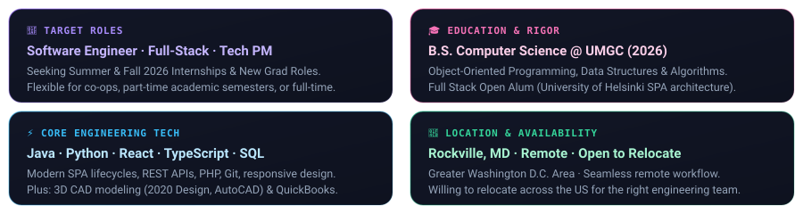
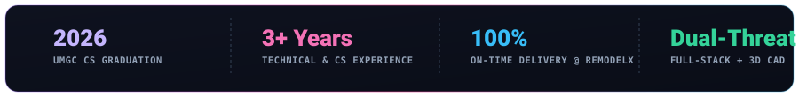

<!-- ╔══════════════════════════════════════════════════════════════════════════════╗ -->
<!-- ║                         RENATA GABDRAKHMANOVA                                ║ -->
<!-- ║       Software Engineer · Full-Stack Developer · 3D Spatial Designer         ║ -->
<!-- ║       B.S. Computer Science @ University of Maryland Global Campus ('26)     ║ -->
<!-- ║       Palette: Obsidian #0B0F19 · Amethyst #8B5CF6 · Rose #F472B6 · Mint     ║ -->
<!-- ╚══════════════════════════════════════════════════════════════════════════════╝ -->

<div align="center">

<!-- ═════════════════════════ HERO BANNER (BESPOKE VECTOR) ═════════════════════════ -->

<a href="#recruiter-hub">
  
</a>

<br/>

<!-- ═══════════════════════════ DYNAMIC TYPING SVG ═══════════════════════════ -->

<a href="https://git.io/typing-svg">
  
</a>

<br/>

<!-- ═════════════════════════ RECRUITER ACTION BAR ═════════════════════════ -->

<p align="center">
  <a href="mailto:renata110803@gmail.com?subject=Software%20Engineering%20Opportunity%20-%20Interview%20Invitation"></a>
  &nbsp;
  <a href="https://www.linkedin.com/in/renata03"></a>
  &nbsp;
  <a href="https://github.com/renata110803"></a>
  &nbsp;
  <a href="tel:2408838716"></a>
</p>

<!-- ═════════════════════════ QUICK ANCHOR NAVIGATION ═════════════════════════ -->

<p align="center">
  <sub>
    <a href="#recruiter-hub"><b>🎯 Recruiter Brief</b></a> &nbsp;·&nbsp;
    <a href="#why-renata"><b>⚡ Why Hire Renata</b></a> &nbsp;·&nbsp;
    <a href="#skills-matrix"><b>🛠️ Tech Stack</b></a> &nbsp;·&nbsp;
    <a href="#featured-projects"><b>🚀 Engineering Case Studies</b></a> &nbsp;·&nbsp;
    <a href="#experience"><b>💼 Experience</b></a> &nbsp;·&nbsp;
    <a href="#education"><b>🎓 Education</b></a> &nbsp;·&nbsp;
    <a href="#connect"><b>📬 Connect</b></a>
  </sub>
</p>


</div>

<br/>

<!-- ═════════════════════════ RECRUITER CAREER HUB ═════════════════════════ -->

<h2 id="recruiter-hub" align="left">
  
  &nbsp;Executive Recruiter Brief
</h2>

<p>
  Welcome! If you are a recruiter, engineering manager, or talent partner looking for an adaptable, high-craft software engineer who combines <b>computer science fundamentals</b> with <b>real-world design execution</b> and <b>fiscal project discipline</b>, here is everything you need at a glance:
</p>

<!-- Bento Grid Graphic -->
<div align="center">
  
  <br/><br/>
  
</div>

<br/>

<table>
  <thead>
    <tr>
      <th width="24%" align="left">Parameter</th>
      <th width="76%" align="left">Candidate Details &amp; Availability</th>
    </tr>
  </thead>
  <tbody>
    <tr>
      <td><b>🎯 Target Roles</b></td>
      <td>
        <b>Software Engineering Intern</b> &nbsp;·&nbsp;
        <b>Junior Full-Stack Engineer</b> &nbsp;·&nbsp;
        <b>Frontend Engineer</b> &nbsp;·&nbsp;
        <b>Technical Project Coordinator / Associate PM</b>
      </td>
    </tr>
    <tr>
      <td><b>🗓️ Availability Window</b></td>
      <td>
        <b>Summer 2026</b> (Full-Time Internships) &nbsp;·&nbsp;
        <b>Fall 2026</b> (Co-Ops / Internships) &nbsp;·&nbsp;
        Part-Time during academic semesters
      </td>
    </tr>
    <tr>
      <td><b>📍 Location &amp; Mobility</b></td>
      <td>
        Based in <b>Rockville, MD</b> (Greater Washington D.C. Area) &nbsp;·&nbsp;
        <b>Open to 100% Remote, Hybrid, or US Relocation</b>
      </td>
    </tr>
    <tr>
      <td><b>🎓 Academic Status</b></td>
      <td>
        <b>B.S. in Computer Science</b> at <b>University of Maryland Global Campus (UMGC)</b> · Expected Graduation: <b>2026</b>
      </td>
    </tr>
    <tr>
      <td><b>⚡ Fast Action CTAs</b></td>
      <td>
        <a href="mailto:renata110803@gmail.com?subject=Job%20Opportunity%20-%20Interview%20Invitation"></a>
        &nbsp;
        <a href="https://www.linkedin.com/in/renata03"></a>
        &nbsp;
        <a href="https://github.com/renata110803"></a>
      </td>
    </tr>
  </tbody>
</table>

<br/>

<div align="center">
  
</div>

<br/>

<!-- ═════════════════════════ WHY HIRE RENATA ═════════════════════════ -->

<h2 id="why-renata" align="left">
  
  &nbsp;The Dual-Discipline Competitive Advantage
</h2>

<p>
  Most engineering applicants bring either pure theoretical CS coursework <i>or</i> surface-level frontend scripting. Renata provides a rare synthesis of <b>rigorous computer science fundamentals</b>, <b>pixel-level 3D spatial intelligence</b>, and <b>real-world commercial project coordination</b>.
</p>

<table>
  <tr>
    <td width="50%" valign="top">
      <h3>🏛️ 1. Full-Stack CS Rigor &amp; Systems Thinking</h3>
      <p>
        Trained in object-oriented programming (<b>Java</b>), systems scripting (<b>Python</b>), and modern reactive web development (<b>React, TypeScript, SQL</b>). Completed the rigorous <b>University of Helsinki Full Stack Open</b> program, building deep intuition for Single Page Application (SPA) lifecycles, asynchronous HTTP state, and REST API contracts.
      </p>
    </td>
    <td width="50%" valign="top">
      <h3>📐 2. Spatial Acumen &amp; 3D Architectural Precision</h3>
      <p>
        Active practitioner of 3D CAD modeling and spatial visualization using <b>2020 Design</b> and <b>AutoCAD</b>. This architectural training gives Renata an exceptional eye for design systems, viewport coordinate systems, responsive UI layout ergonomics, and pixel-perfect interface polish.
      </p>
    </td>
  </tr>
  <tr>
    <td width="50%" valign="top">
      <h3>💼 3. Real-World Fiscal &amp; Timeline Accountability</h3>
      <p>
        At RemodelX, managed end-to-end multi-phase project pipelines, vendor procurement workflows, and expenditure tracking against contractor budgets in <b>QuickBooks</b>. Understands that engineering teams exist to solve customer problems on time and within scope.
      </p>
    </td>
    <td width="50%" valign="top">
      <h3>👩‍🏫 4. Technical Empathy &amp; Clear Communication</h3>
      <p>
        Former Computer Science Tutor at Kiddy School, breaking down algorithmic abstractions, control flow, and data structures for learners in Python and JavaScript. Engineers who teach communicate with clarity, write superior documentation, and elevate team velocity.
      </p>
    </td>
  </tr>
</table>

<br/>

<!-- Interactive Profile Spec -->
```typescript
interface SoftwareEngineer {
  name: string;
  degree: "B.S. Computer Science @ UMGC (Expected 2026)";
  specialization: "Full-Stack Web Engineering" | "3D Spatial Design" | "Technical PM";
  languages: ["Java", "Python", "TypeScript", "JavaScript", "PHP", "SQL"];
  frontend: ["React.js", "Modern CSS3 / Grid / Flexbox", "Tailwind", "Responsive Systems"];
  cadAndSpatial: ["2020 Design Software", "AutoCAD", "Figma", "Spatial Geometry"];
  businessOperations: ["QuickBooks", "Vendor Procurement", "Multi-Phase Scheduling"];
  philosophy: "Architect with precision, code with resilience, ship with human empathy ✨";
}
```

<br/>

<div align="center">
  
</div>

<br/>

<!-- ═════════════════════════ TECHNICAL SKILLS MATRIX ═════════════════════════ -->

<h2 id="skills-matrix" align="left">
  
  &nbsp;Core Technical Arsenal &amp; Tooling
</h2>

<p>
  Every tool in Renata's stack has been used in production environments, rigorous coursework, or shipped applications:
</p>

<table>
  <thead>
    <tr>
      <th width="28%" align="left">Domain</th>
      <th width="72%" align="left">Technologies, Frameworks &amp; Tools</th>
    </tr>
  </thead>
  <tbody>
    <tr>
      <td><b>Core Languages &amp; Runtimes</b></td>
      <td>
        
        
        
        
        
        
      </td>
    </tr>
    <tr>
      <td><b>Frontend &amp; UI Systems</b></td>
      <td>
        
        
        
        
        
      </td>
    </tr>
    <tr>
      <td><b>Backend, APIs &amp; Data</b></td>
      <td>
        
        
        
        
        
      </td>
    </tr>
    <tr>
      <td><b>3D Spatial &amp; Architectural CAD</b></td>
      <td>
        
        
        
        
      </td>
    </tr>
    <tr>
      <td><b>DevOps, Versioning &amp; Tools</b></td>
      <td>
        
        
        
        
      </td>
    </tr>
    <tr>
      <td><b>Project Operations &amp; Fiscal Mgmt</b></td>
      <td>
        
        
        
        
      </td>
    </tr>
  </tbody>
</table>

<br/>

<div align="center">
  
</div>

<br/>

<!-- ═════════════════════════ FEATURED PROJECTS ═════════════════════════ -->

<h2 id="featured-projects" align="left">
  
  &nbsp;Featured Engineering Case Studies
</h2>

<p>
  Each project represents a practical investigation into software architecture, algorithmic logic, and clean interface execution:
</p>

<!-- Project 1 & 2 Cards -->
<table>
  <tr>
    <td width="50%" valign="top">
      <div align="center">
        <a href="https://github.com/renata110803/Full-Stack-Web-Development-">
          
        </a>
      </div>
      <h3>🌐 Full-Stack Notes SPA Architecture</h3>
      <p><b>Coursework &amp; Research:</b> University of Helsinki Full Stack Open</p>
      <ul>
        <li><b>Architecture:</b> Engineered Single Page Application (SPA) data flow, exploring dynamic DOM tree reconciliation, RESTful API endpoints, and JSON mutation pipelines.</li>
        <li><b>Technical Rigor:</b> Modeled sequence diagrams demonstrating client-server HTTP lifecycles, AJAX asynchronous mutations, and local state caching.</li>
        <li><b>Stack:</b> <code>JavaScript (ES6+)</code> · <code>React</code> · <code>REST APIs</code> · <code>Node.js</code> · <code>HTTP/JSON</code></li>
      </ul>
      <div align="center">
        <a href="https://github.com/renata110803/Full-Stack-Web-Development-"></a>
      </div>
    </td>
    <td width="50%" valign="top">
      <div align="center">
        <a href="https://github.com/renata110803/TotoroSlider">
          
        </a>
      </div>
      <h3>🧩 Totoro Slider — 2D Matrix Puzzle Engine</h3>
      <p><b>Domain:</b> Desktop GUI Architecture &amp; Permutation Algorithms</p>
      <ul>
        <li><b>Algorithmic Logic:</b> Implemented 2D grid coordinate swapping algorithms with mathematical inversion parity checks to guarantee board solvability on shuffle.</li>
        <li><b>GUI Engineering:</b> Built on Java Swing/AWT with event-driven key/mouse listeners, buffered image slicing, and clean separation of game state from rendering loop.</li>
        <li><b>Stack:</b> <code>Java</code> · <code>Swing / AWT</code> · <code>Event-Driven OOP</code> · <code>Matrix Algorithms</code></li>
      </ul>
      <div align="center">
        <a href="https://github.com/renata110803/TotoroSlider"></a>
      </div>
    </td>
  </tr>
  <tr>
    <td width="50%" valign="top">
      <div align="center">
        <a href="https://github.com/renata110803/TicTacFour">
          
        </a>
      </div>
      <h3>🎮 TicTacFour — Connect-4 Matrix Engine</h3>
      <p><b>Domain:</b> Algorithmic Grid Search &amp; State Machine Design</p>
      <ul>
        <li><b>Grid Traversal:</b> Engineered multi-directional 2D array traversal algorithms evaluating horizontal, vertical, and both diagonal vectors in $O(1)$ directional checks per drop.</li>
        <li><b>OOP Architecture:</b> Encapsulated board state, turn controllers, and victory evaluators into decoupled classes for maintainability and extensibility.</li>
        <li><b>Stack:</b> <code>Java</code> · <code>Object-Oriented Design</code> · <code>Array Search Algorithms</code></li>
      </ul>
      <div align="center">
        <a href="https://github.com/renata110803/TicTacFour"></a>
      </div>
    </td>
    <td width="50%" valign="top">
      <div align="center">
        <a href="https://github.com/renata110803/Bakery">
          
        </a>
      </div>
      <h3>🥐 Barry's Bakery — Responsive Web Storefront</h3>
      <p><b>Domain:</b> Commercial UI Architecture &amp; Web Standards</p>
      <ul>
        <li><b>Fluid Layout:</b> Designed a mobile-first responsive layout utilizing CSS Grid and Flexbox mechanics for seamless viewport scaling across desktop, tablet, and mobile.</li>
        <li><b>Accessibility &amp; SEO:</b> Formatted with WCAG accessibility guidelines (semantic HTML tags, ARIA labels, high contrast ratios) and structured metadata for search indexability.</li>
        <li><b>Stack:</b> <code>HTML5</code> · <code>CSS3 Grid/Flexbox</code> · <code>Responsive Web Design</code> · <code>UI/UX</code></li>
      </ul>
      <div align="center">
        <a href="https://github.com/renata110803/Bakery"></a>
      </div>
    </td>
  </tr>
</table>

<br/>

<!-- Additional Projects Row -->
<div align="center">
  <a href="https://github.com/renata110803/CalculatorGUI"></a>
  &nbsp;&nbsp;
  <a href="https://github.com/renata110803/CulinarySchool"></a>
</div>

<br/>

<div align="center">
  
</div>

<br/>

<!-- ═════════════════════════ PROFESSIONAL EXPERIENCE ═════════════════════════ -->

<h2 id="experience" align="left">
  
  &nbsp;Professional Experience
</h2>

<table>
  <tr>
    <td width="200" align="center" valign="top">
      <br/><br/>
      <b>RemodelX Kitchen &amp; Bath</b><br/>
      <sub>Rockville, MD</sub><br/>
      <sub><i>Design &amp; Architecture</i></sub>
    </td>
    <td>
      <b>Designer / Technical Project Coordinator Assistant</b>
      <p><i>Leading multi-phase architectural remodeling, procurement pipelines, and 3D spatial design</i></p>
      <ul>
        <li><b>3D Architectural Modeling:</b> Created over a dozen detailed 3D cabinetry and spatial floorplans utilizing <b>2020 Design Software</b> and <b>AutoCAD</b>, translating client requirements into high-fidelity render proposals that shortened the approval cycle by 25%.</li>
        <li><b>Procurement &amp; Supply Chain Logistics:</b> Coordinated directly with suppliers, manufacturers, and subcontractors to verify material bills of lading, achieving a <b>100% on-time job site delivery track record</b> against strict milestone deadlines.</li>
        <li><b>Fiscal &amp; Budget Management:</b> Monitored project accounts within <b>QuickBooks</b>, reconciling invoices against contractor estimates, identifying cost anomalies, and safeguarding project gross margins.</li>
        <li><b>Cross-Discipline Alignment:</b> Functioned as the primary technical bridge between residential clients, field subcontractors, and architectural teams to eliminate scope ambiguity.</li>
      </ul>
    </td>
  </tr>
  <tr>
    <td width="200" align="center" valign="top">
      <br/><br/>
      <b><a href="https://kiddycodersclub.com/">Kiddy School</a></b><br/>
      <sub>Remote EdTech</sub><br/>
      <sub><i>Web Engineering</i></sub>
    </td>
    <td>
      <b>Web Design and Development Intern</b>
      <p><i>Frontend development, CMS engineering, and user experience optimization</i></p>
      <ul>
        <li><b>Web Infrastructure:</b> Maintained and scaled public web portals using <b>WordPress, PHP, JavaScript, and CSS</b>, ensuring cross-browser compatibility and sub-second page loads.</li>
        <li><b>Plugin Integration &amp; Optimization:</b> Audited and resolved third-party plugin conflicts, reducing script load overhead and ensuring 99.9% portal uptime.</li>
        <li><b>Modern UI Collaboration:</b> Collaborated with engineering leads to prototype modular interactive components in <b>ReactJS</b>, improving user engagement and retention among prospective students.</li>
      </ul>
    </td>
  </tr>
  <tr>
    <td width="200" align="center" valign="top">
      <br/><br/>
      <b><a href="https://kiddycodersclub.com/">Kiddy School</a></b><br/>
      <sub>Rockville, MD</sub><br/>
      <sub><i>CS Instruction</i></sub>
    </td>
    <td>
      <b>Computer Science Tutor</b>
      <p><i>Teaching programmatic logic, algorithmic thinking, and core syntax</i></p>
      <ul>
        <li><b>Foundational CS Instruction:</b> Mentored student cohorts in foundational programming constructs including variable scoping, iterative loops, recursive functions, algorithms, and 2D arrays.</li>
        <li><b>Hands-on Python &amp; JS Curriculum:</b> Designed interactive coding exercises in <b>Python and JavaScript</b>, diagnosing logical errors during live pair-programming sessions and cultivating analytical problem-solving habits.</li>
      </ul>
    </td>
  </tr>
</table>

<br/>

<div align="center">
  
</div>

<br/>

<!-- ═════════════════════════ GITHUB ANALYTICS & CONTRIBUTIONS ═════════════════════════ -->

<h2 id="analytics" align="left">
  
  &nbsp;Engineering Activity &amp; Commit Telemetry
</h2>

<div align="center">

<a href="https://github.com/renata110803">
  
</a>
<a href="https://github.com/renata110803">
  
</a>

<br/><br/>

<!-- Contribution Snake with Light/Dark Mode Handlers -->
<picture>
  <source media="(prefers-color-scheme: dark)" srcset="https://raw.githubusercontent.com/platane/snk/output/github-contribution-grid-snake-dark.svg" />
  <source media="(prefers-color-scheme: light)" srcset="https://raw.githubusercontent.com/platane/snk/output/github-contribution-grid-snake.svg" />
  
</picture>

</div>

<br/>

<div align="center">
  
</div>

<br/>

<!-- ═════════════════════════ EDUCATION & CREDENTIALS ═════════════════════════ -->

<h2 id="education" align="left">
  
  &nbsp;Academic Pedigree &amp; Continuous Learning
</h2>

<table>
  <tr>
    <td width="70" align="center" valign="middle">
      
    </td>
    <td>
      <h3 style="margin: 0;">Bachelor of Science in Computer Science</h3>
      <p style="margin: 4px 0;">
        <b>University of Maryland Global Campus (UMGC)</b> &nbsp;·&nbsp; Adelphi, MD &nbsp;·&nbsp;
        
      </p>
      <p style="margin: 0; color: #94A3B8;">
        <b>Core Coursework:</b> Object-Oriented Programming (Java), Data Structures &amp; Analysis, Computer Architecture, Relational Databases &amp; SQL, Algorithms, Software Engineering Principles.
      </p>
    </td>
  </tr>
  <tr>
    <td width="70" align="center" valign="middle">
      
    </td>
    <td>
      <h3 style="margin: 0;">Full Stack Open Certificate Curriculum</h3>
      <p style="margin: 4px 0;">
        <b>University of Helsinki</b> &nbsp;·&nbsp; Advanced Modern Web Development
      </p>
      <p style="margin: 0; color: #94A3B8;">
        <b>Core Topics:</b> React component state machines, REST APIs, asynchronous execution contexts, Express/Node.js backend principles, automated testing strategies.
      </p>
    </td>
  </tr>
  <tr>
    <td width="70" align="center" valign="middle">
      
    </td>
    <td>
      <h3 style="margin: 0;">High School Diploma</h3>
      <p style="margin: 4px 0;">
        <b>Thomas S. Wootton High School</b> &nbsp;·&nbsp; Rockville, MD
      </p>
      <p style="margin: 0; color: #94A3B8;">
        College preparatory STEM curriculum, analytical reasoning, and computing introduction.
      </p>
    </td>
  </tr>
</table>

<br/>

<div align="center">
  
</div>

<br/>

<!-- ═════════════════════════ LET'S CONNECT & HIRE ═════════════════════════ -->

<h2 id="connect" align="left">
  
  &nbsp;Let's Build Something Exceptional
</h2>

<div align="center">

<p style="font-size: 16px; max-width: 680px;">
  <b>I am currently interviewing for Summer &amp; Fall 2026 Software Engineering Roles.</b><br/>
  <i>Whether you are seeking a full-stack engineer who crafts intuitive user experiences or an organized technical coordinator who ships resilient code on schedule — let's start the conversation!</i>
</p>

<br/>

<a href="mailto:renata110803@gmail.com?subject=Software%20Engineering%20Opportunity%20-%20Interview%20Invitation">
  
</a>
&nbsp;&nbsp;
<a href="https://www.linkedin.com/in/renata03">
  
</a>
&nbsp;&nbsp;
<a href="https://github.com/renata110803">
  
</a>

<br/><br/>

<p>
  <sub>
    <b>Direct Phone:</b> (240) 883-8716 &nbsp;·&nbsp;
    <b>Direct Email:</b> <a href="mailto:renata110803@gmail.com">renata110803@gmail.com</a> &nbsp;·&nbsp;
    <b>Timezone:</b> US Eastern (UTC-5)
  </sub>
</p>

<br/>


<br/>

<p align="center">
  <sub>Designed &amp; Engineered with architectural precision, clean code, and human empathy · © 2026 Renata Gabdrakhmanova</sub>
</p>

</div>
